# Noise-Resilient Variational Classifier — Fraud on a Quantum Budget

**Hackathon:** BreaQ Quantum AI Hackathon  
**Team:** Sick7  
**Challenge Track:** Task 2 — Noise-Resilient Variational Quantum Classifier on a Realistic Hardware Budget  

---

## Executive Summary

Credit card fraud detection is an extreme rare-event ranking problem: in the benchmark ULB dataset, only **492 of 284,807 transactions (0.172%)** are fraudulent. Near-term Variational Quantum Classifiers (VQCs) face two fundamental hardware bottlenecks on this task:
1. **Gate noise scrambles transaction rankings:** In the reference 4-qubit VQC (93 native gates, 33 CNOTs, 126 noise locations), simulated 5% depolarizing gate noise degrades test AUPRC from `0.580 ± 0.053` to `0.405 ± 0.177` and collapses rank correlation with noiseless predictions to Spearman $\rho = 0.686 \pm 0.145$ (and to `0.013 ± 0.008` AUPRC under realistic 1,024-shot readout).
2. **Hardware execution budgets are prohibitive:** Analytic parameter-shift gradients and per-epoch full-validation sweeps require **2,434,560 circuit executions** (`2.49 × 10⁹` shots at 1,024 shots/execution) per training seed.

We introduce the **Noise-Covariant Re-uploading Classifier (NCRC)** (`ncrc_4q_L4`), an entanglement-free, multi-wire data re-uploading VQC paired with a **compiled packed parameter-shift gradient backend**. Because single-qubit depolarizing channels commute with every single-qubit unitary, eliminating entangling gates and balancing gate counts across wires collapses all mid-circuit noise into a single uniform affine contraction of the fraud score. As a result, **transaction ordering is mathematically invariant to depolarizing noise** ($\rho = 1.000$ across all noise levels), achieving **0.735 ± 0.017 test AUPRC** at every official noise level ($p \in \{0, 0.001, 0.01, 0.05\}$)—outperforming both the noisy baseline (`+0.330` AUPRC at $p = 0.05$) and the classical Logistic Regression reference (`0.703 ± 0.010`) on the exact same 4 encoded features, while cutting hardware executions by **19%** on the full schedule (`1,974,360` runs) and by **88%** on a frugal validation schedule (`303,630` runs, `0.721 ± 0.021` AUPRC).

| Model | Tag | Native Gates (CNOTs) | Noise Locations | Test AUPRC ($p = 0.01$) | Test AUPRC ($p = 0.05$) | Spearman $\rho$ ($p = 0.05$) | Test $F_1$ ($p = 0.05$) | Train + Val Executions / Seed |
|---|---|---:|---:|---:|---:|---:|---:|---:|
| Baseline VQC (Task 1) | `baseline` | 93 (33) | 126 | 0.564 ± 0.049 | 0.405 ± 0.177 | 0.686 ± 0.145 | 0.537 ± 0.184 | 2,434,560 |
| Classical Reference | `logreg` | 0 (0) | 0 | 0.703 ± 0.010 | 0.703 ± 0.010 | — | 0.791 ± 0.019 | 0 |
| Entangled NCRC (ablation) | `ncrc_4q_L4_cnot` | 25 (9) | 34 | 0.744 ± 0.021 | 0.712 ± 0.042 | 0.997 ± 0.003 | 0.799 ± 0.011 | 3,425,760 |
| **NCRC (ours, headline)** | `ncrc_4q_L4` | **16 (0)** | **16** | **0.735 ± 0.017** | **0.735 ± 0.017** | **1.000 ± 0.000** | **0.763 ± 0.035** | **1,974,360 (−19%)** |
| **NCRC (cheap + packed)** | `ncrc_4q_L4_cheap_packed` | **16 (0)** | **16** | **0.721 ± 0.021** | **0.721 ± 0.021** | **1.000 ± 0.000** | **0.772 ± 0.036** | **303,630 (−88%)** |
| NCRC + Ranking Loss | `ncrc_4q_L4_pairwise05` | 16 (0) | 16 | 0.747 ± 0.014 | 0.747 ± 0.014 | 1.000 ± 0.000 | 0.796 ± 0.025 | 3,425,760 |

---

## Table of Contents

1. [Hackathon Task Description](#1-hackathon-task-description)
2. [Our Approach: Noise-Covariant Re-uploading Classifier (NCRC)](#2-our-approach-noise-covariant-re-uploading-classifier-ncrc)
3. [Experimental Results & Most Relevant Graphs](#3-experimental-results--most-relevant-graphs)
4. [Project Structure](#4-project-structure)
5. [Verification, Nuances & Information Worth Mentioning](#5-verification-nuances--information-worth-mentioning)
6. [References](#6-references)

---

## 1. Hackathon Task Description

### 1.1 Overview & Background
The **Fraud on a Quantum Budget** challenge builds on Dinuț et al. (2026) [1], who benchmarked 4-qubit quantum kernel SVMs and VQCs against classical models on financial fraud detection under simulated depolarizing noise. Two empirical findings motivated the competition design:
1. At 4 qubits, the standard VQC lags tuned classical models on the same compressed inputs, requiring every quantum result to be benchmarked side-by-side against a classical reference.
2. Under gate noise, single-threshold metrics or isolated runs can behave erratically even while underlying score rankings deteriorate, requiring multi-seed evaluation across both ranking and thresholded metrics.

The hackathon comprises two stages:
- **Task 1 (Guided Learning Stage — Unjudged):** An 11-part tutorial notebook (`Hackathon Tasks/task1_guided_vqc_fraud_detection.ipynb`) walking through PyTorch optimization, rare-event metrics, leak-free preprocessing, PennyLane QNodes, the 4-qubit baseline VQC, hardware execution accounting via `qml.Tracker`, and noisy density-matrix evaluation.
- **Task 2 (Open Competition — Judged):** Design, implement, and benchmark an end-to-end noise-resilient VQC pipeline from raw data to final multi-seed tables within a 24-hour window, optimizing predictive ranking under noise while minimizing quantum hardware executions.

### 1.2 Dataset & Common Stratified Split
- **Dataset:** ULB Credit Card Fraud (Dal Pozzolo et al., 2015 [2]; Kaggle `mlg-ulb/creditcardfraud` / OpenML `42175`), recording two days of European cardholder transactions in September 2013.
  - **Size & Imbalance:** `284,807` total transactions with `492` frauds (`0.1727%` positive class) and `284,315` legitimate payments. A trivial classifier predicting "legitimate" on every row achieves `99.83%` accuracy while catching zero fraud, rendering standard accuracy meaningless.
  - **Features:** 30 numerical columns — `V1`–`V28` (anonymized PCA components) plus raw `Time` (seconds elapsed since first transaction) and `Amount`.
- **Mandatory Common Split (`split_indices.npz`):** Stratified `60% / 20% / 20%` partition generated with `random_state = 42` prior to any resampling or scaling:
  - **Training set:** `170,883` transactions (`295` frauds, `0.1726%`)
  - **Validation set:** `56,962` transactions (`99` frauds, `0.1738%`)
  - **Test set:** `56,962` transactions (`98` frauds, `0.1720%`)

### 1.3 Mandatory Deliverables
Every submission is required to provide:
1. **Task 1 Baseline VQC:** Evaluated across 5 fixed seeds (`SEEDS = [0, 1, 2, 3, 4]`) under the official noise protocol.
2. **Noise-Resilient Improvement:** At least one original architectural or algorithmic method targeting noise robustness, evaluated over $\ge 5$ seeds against the baseline.
3. **Classical Reference:** At minimum `LogisticRegression(max_iter=1000)` trained on the exact same encoded feature representations per seed.
4. **Hardware Cost Ledger:** Exact training and validation circuit executions and measurement shots (`1,024` shots/execution default), counted via formula or `qml.Tracker`.
5. **Reproducible Codebase:** Seed-controlled Python implementation (`PennyLane`, `PyTorch`, `scikit-learn`) running end-to-end from `split_indices.npz` to summary tables.
6. **Presentation Deck (`.pptx` / `.pdf`):** Replacing a traditional prose report, covering pipeline design, circuit rationale, noise-resilience theory, multi-seed results, cost ledger, and **honest negative results / ablations**.

### 1.4 Hard Constraints & Official Evaluation Protocol
- **Zero Data Leakage:** Training set balancing (1:1 random undersampling to `295` frauds + `295` legitimate = `590` rows per seed), feature standardization, PCA, and angle scaling must be fitted **exclusively on the training partition**. Validation and test sets retain the natural `0.172%` fraud rate.
- **VQC Requirement:** Classification must originate from quantum state evolution and measurement. Classical input maps and affine output rescaling are permitted, but post-hoc classical classifiers on top of quantum features are not.
- **Native Gate Set & Depolarizing Noise Model:** Every circuit is decomposed into the native gate set
  $$\mathcal{G} = \{\text{RX}, \text{RY}, \text{RZ}, \text{Rot}, \text{Hadamard}, \text{CNOT}, \text{CZ}\}$$
  followed by a single-qubit depolarizing channel $\mathcal{D}_p$ of probability $p$ on **every wire touched by every native gate** (1 channel per single-qubit gate, 2 channels per CNOT/CZ). Official evaluation runs exact density-matrix simulation (`default.mixed`) at:
  $$p \in \{0.0,\; 0.001,\; 0.01,\; 0.05\}$$
- **Validation Threshold Calibration:** For each model, seed, and noise level $p$, the binary alert threshold $\tau_p$ is selected to maximize $F_1$ on the **validation set evaluated at the same noise level $p$**. (This recalibration is part of the shared protocol and does not count as a standalone innovation.)
- **Judging Metrics:**
  - **Primary:** Test **AUPRC** (Average Precision) at $p = 0.01$ and $p = 0.05$ (random baseline $\approx 0.00172$).
  - **Robustness:** **Spearman rank correlation ($\rho$)** between noisy and noiseless test scores.
  - **Secondary:** **AUROC**, **Precision**, **Recall**, **$F_1$**, and **MCC** (Matthews Correlation Coefficient) at $\tau_p$, reported as $\text{mean} \pm \text{std}$ across 5 seeds.

---

## 2. Our Approach: Noise-Covariant Re-uploading Classifier (NCRC)

### 2.1 Shared Leak-Free Preprocessing Pipeline
To ensure an apples-to-apples comparison, every model (Baseline VQC, Logistic Regression, NCRC, and all ablations) consumes the exact same per-seed data representation (`src/common.py::prepare_seed`):
1. **Undersampling:** Draw all `295` training frauds plus `295` seed-controlled random legitimate training rows (`590` balanced training samples).
2. **`AngleEncoder` (fitted strictly on the 590 training rows):**
   - `StandardScaler` applied to raw `Time` and `Amount` (`V1`–`V28` are already zero-mean PCA features).
   - `PCA(n_components=4, random_state=seed)` projecting 30 features to 4 orthogonal components.
   - `MinMaxScaler(feature_range=(0, π))` mapping components to rotation angles, clipped to $[0, \pi]$ at inference on validation/test sets.

### 2.2 Diagnosing the Task 1 Baseline Failure
The Task 1 circuit stacks a 2-repetition all-to-all `ZZFeatureMap` (`8 Hadamard`, `12 RZ`, `24 CNOT` + `12 RZ` pairwise interactions) with a 3-repetition `EfficientSU2`-style ansatz (`16 RY`, `16 RZ`, `9 CNOT`), measuring $\langle Z_0 \rangle$ and mapping $s(x) = (1 - \langle Z_0 \rangle)/2$:
- **126 Noise Locations:** `60` single-qubit gates + `33` two-qubit CNOTs (`33 × 2 = 66` wire channels) across depth 45.
- **Why Rankings Scramble:** Because CNOT gates entangle wires mid-circuit, a Pauli error occurring before a CNOT propagates across wires into multi-qubit Pauli errors. Different input states traverse different trajectories on the joint Hilbert space, suffering **input-dependent attenuation**. Transaction A with clean score `0.80` can shrink more sharply toward `0.50` than Transaction B with clean score `0.70`, inverting their rank order ($\rho = 0.686$ at $p = 0.05$).
- **Dead Parameters & Cost Waste:** Of the 32 ansatz angles, 12 lie outside qubit 0's backward causal light-cone and the final `RZ` on wire 0 commutes with $Z_0$, leaving only $P_{\text{active}} = 19$ functional parameters (`qml.Tracker` records `41` executions/sample instead of the naive formula's `1 + 2 × 32 = 65`). Even more critically, scoring all `56,962` validation rows after each of 30 epochs consumes **1,708,860 executions**—70% of the entire hardware budget.

### 2.3 Core Theorem: Exact Ranking Invariance via Noise Covariance
A single-qubit depolarizing channel shrinks any state's Bloch vector isotropically by $\lambda = 1 - \frac{4p}{3}$:
$$\mathcal{D}_p(\rho) = (1 - p)\rho + \frac{p}{3}(X\rho X + Y\rho Y + Z\rho Z)$$
Because isotropic contraction commutes with every $SU(2)$ rotation $U \in SU(2)$,
$$\mathcal{D}_p(U \rho U^\dagger) = U \mathcal{D}_p(\rho) U^\dagger$$
we architect **NCRC** around three structural conditions:
1. **Zero Entangling Gates (`0 CNOTs`):** Every wire evolves independently, allowing every depolarizing channel $\mathcal{D}_p$ after each gate to commute all the way to the end of its wire.
2. **Equal Gate Count per Wire ($k$ native gates on each wire):** Each wire accumulates the exact same total contraction $\mathcal{D}_p^{\circ k}$, scaling its noiseless expectation value uniformly:
   $$\langle Z_q \rangle_p(x) = \left(1 - \frac{4p}{3}\right)^k \langle Z_q \rangle_0(x)$$
3. **Ensemble Mean-$Z$ Readout:** Averaging all $n$ wires via $\bar{Z} = \frac{1}{n}\sum_{q=0}^{n-1} \langle Z_q \rangle$ maps every transaction's fraud probability by the **exact same strictly increasing affine function**:
   $$s_p(x) = \frac{1 - \bar{Z}_p(x)}{2} = \frac{1}{2} + \left(1 - \frac{4p}{3}\right)^k \left(s_0(x) - \frac{1}{2}\right)$$

**Direct Consequences:**
- For any $p < 0.75$, $\lambda = 1 - \frac{4p}{3} > 0$, so $s_0(x_i) > s_0(x_j) \iff s_p(x_i) > s_p(x_j)$ for **every** pair of transactions.
- **AUPRC, AUROC, and Spearman $\rho = 1.000$ are mathematically invariant** to $p$ in exact (density-matrix) evaluation.
- Because validation scores undergo the identical positive affine transformation, the max-$F_1$ validation threshold transforms as $\tau_p = \frac{1}{2} + \lambda^k(\tau_0 - \frac{1}{2})$, flagging the **exact same set of test transactions** at every $p$ and preserving Precision, Recall, $F_1$, MCC, and confusion counts bit-for-bit.

### 2.4 Expressivity Without Entanglement: Affine Data Re-uploading
Without CNOTs, single-pass angle encoding can only form separable productfunctions. We restore rich nonlinear decision boundaries via **data re-uploading** (Pérez-Salinas et al., 2020 [3]):

```
Wire q (q = 0..3):  |0⟩ ── Rot(φ_{q,0}, θ_{q,0}, ω_{q,0}) ── ... ── Rot(φ_{q,3}, θ_{q,3}, ω_{q,3}) ── ⟨Z_q⟩
                                      ↑                                            ↑
                         (φ, θ, ω)_{q,l} = W_{q,l} · x + b_{q,l}     (all 4 PCA angles mixed at every layer)
```

- Each layer applies **one native `qml.Rot(φ, θ, ω)` gate** (`1` noise location per wire per layer), where all three Euler angles are trainable affine projections $W_{q,l} x + b_{q,l}$ of the 4-dimensional input vector $x \in [0, \pi]^4$.
- Repeated non-commuting $SU(2)$ rotations generate a truncated multivariate Fourier series of degree $L$ per wire; averaging $n = 4$ differently initialized wires acts as a **quantum ensemble** that smooths variance and halves finite-shot measurement noise ($\sigma_{\text{mean}} = \sigma_{\text{wire}} / \sqrt{4} = \sigma_{\text{wire}} / 2$).
- **Headline Configuration (`ncrc_4q_L4`):** Selected strictly by highest 5-seed mean **validation AUPRC** (`0.724 ± 0.011`) before viewing test metrics: `4` wires $\times$ `4` layers = **16 native `Rot` gates, 0 CNOTs, 16 noise locations, depth 4**, parameterized by `4 × 4 × 3 × (4 + 1) = 240` classical weights defining `48` gate angles.

### 2.5 Hardware Cost Optimization: Pruning, Packed Gradients & Cheap Schedule
Because `ncrc_4q_L4` has `48` gate angles, naive parameter-shift differentiation would require `1 + 2 × 48 = 97` circuit executions per training sample—more than the baseline's `41`. We engineered three complementary cost reductions (`src/models.py`, `src/common.py::PackedNCRCGradient`):

1. **Endpoint Local-$Z$ Pruning (`97 → 81` exec/sample, lossless):**
   Decomposing $\text{Rot}(\phi, \theta, \omega) = R_Z(\omega) R_Y(\theta) R_Z(\phi)$, the first layer's leading $R_Z(\phi_{q,0})$ acts on $|0\rangle$ (producing an unobservable global phase) and the final layer's trailing $R_Z(\omega_{q,L-1})$ commutes with the Pauli-$Z_q$ measurement. Fixing both to `0` preserves the exact function class and gradients ($\sim 10^{-16}$) while saving $2 \times 2 \times 4 = 16$ shifted runs per sample (`13 → 9` on 1-qubit $L=2$).
2. **Compiled Packed Parameter-Shift Backend (`81 → 15` exec/sample, exact):**
   - **Euler $Z$-Angle Fusion:** Between consecutive layers $l$ and $l+1$ on wire $q$, the trailing $R_Z(\omega_{q,l})$ and next leading $R_Z(\phi_{q,l+1})$ merge into a single rotation $R_Z(\beta_{q,l})$ with $\beta_{q,l} = \omega_{q,l} + \phi_{q,l+1}$. Combined with endpoint pruning, each 4-layer wire has only $L + (L - 1) = 2L - 1 = 7$ active coordinates (`4 θ` + `3 β`), cutting sequential shifts to `1 + 2 × 28 = 57` exec/sample.
   - **Parallel Independent-Wire Shifting:** Because the 4 wires share zero entangling gates, shifting coordinate slot $k \in \{0, \dots, 6\}$ by $\pm \frac{\pi}{2}$ **simultaneously on all 4 wires** in a single circuit run and recording the 4-tuple $(\langle Z_0 \rangle, \langle Z_1 \rangle, \langle Z_2 \rangle, \langle Z_3 \rangle)$ yields the exact parameter-shift derivative for every wire in parallel, then pulls gradients back to $(W, b)$ via chain rule.
   - Total training cost drops to **`1 + 2 × 7 = 15` executions/sample**—an **84.5% reduction in training executions** (`1,716,900 → 265,500`), verified to match standard backpropagation and Adam updates within `1e-9` at both $p = 0$ and $p = 0.05$ (`tests/test_packed_gradient.py`).
3. **Frugal Validation Schedule (`1,974,360 → 303,630` total executions, −88% vs. baseline):**
   Training for `15` epochs instead of `30` and selecting the best checkpoint on a stratified `20%` validation subset (`11,392` rows) reduces validation runs by `90%` (`1,708,860 → 170,880`) while retaining **0.721 ± 0.021 test AUPRC** at every noise level.

### 2.6 Optional Pairwise Ranking Loss (`ncrc_4q_L4_pairwise05`)
Standard binary cross-entropy (BCE) calibrates pointwise probabilities rather than relative fraud-vs-legitimate ordering. We implemented an optional composite loss adding a smooth pairwise margin penalty across positive ($S^+$) and negative ($S^-$) scores within each minibatch:
$$\mathcal{L} = \mathcal{L}_{\text{BCE}}(s, y) + \alpha \cdot \frac{1}{|S^+||S^-|} \sum_{i \in S^+} \sum_{j \in S^-} \text{softplus}\!\left(-(s_i - s_j)\right), \quad \alpha = 0.5$$
Selected via validation pilot (`0.727 ± 0.006` 5-seed validation AUPRC vs. `0.724 ± 0.011` plain BCE), this variant keeps the identical 16-gate noise-covariant circuit while boosting test $F_1$ to **0.796 ± 0.025** (beating Logistic Regression's `0.791`) and test AUPRC to **0.747 ± 0.014** (at `97` exec/sample, as `PackedNCRCGradient` currently targets standard per-sample losses).

---

## 3. Experimental Results & Most Relevant Graphs

All official protocol experiments evaluate the untouched full common test set (**56,962 transactions, 98 frauds**) across **`SEEDS = [0, 1, 2, 3, 4]`**, reporting `mean ± std`.

### 3.1 Official Noise Protocol Benchmark
Under exact density-matrix simulation of the native-gate depolarizing noise model, NCRC maintains **bit-identical metrics across all four noise levels**, whereas the Task 1 Baseline loses `30.2%` of its clean AUPRC by $p = 0.05$ and suffers a `3.3×` explosion in seed-to-seed standard deviation (`0.053 → 0.177`).

| Model | $p$ | Test AUPRC | AUROC | Spearman $\rho$ | Precision | Recall | $F_1$ | MCC |
|---|---:|---:|---:|---:|---:|---:|---:|---:|
| **Baseline VQC** (`baseline`) | 0.000 | 0.580 ± 0.053 | 0.968 ± 0.003 | 1.000 ± 0.000 | 0.682 ± 0.061 | 0.624 ± 0.027 | 0.650 ± 0.031 | 0.651 ± 0.032 |
| | 0.001 | 0.580 ± 0.053 | 0.968 ± 0.003 | 1.000 ± 0.000 | 0.683 ± 0.068 | 0.620 ± 0.040 | 0.648 ± 0.037 | 0.649 ± 0.038 |
| | 0.010 | 0.564 ± 0.049 | 0.968 ± 0.003 | 0.982 ± 0.010 | 0.675 ± 0.037 | 0.645 ± 0.040 | 0.659 ± 0.030 | 0.659 ± 0.030 |
| | 0.050 | 0.405 ± 0.177 | 0.955 ± 0.024 | 0.686 ± 0.145 | 0.487 ± 0.198 | 0.622 ± 0.158 | 0.537 ± 0.184 | 0.545 ± 0.177 |
| **Logistic Regression** (`logreg`) | all $p$ | 0.703 ± 0.010 | 0.976 ± 0.003 | — | 0.776 ± 0.029 | 0.808 ± 0.013 | 0.791 ± 0.019 | 0.791 ± 0.018 |
| **Entangled NCRC** (`ncrc_4q_L4_cnot`) | 0.000 | 0.744 ± 0.022 | 0.973 ± 0.002 | 1.000 ± 0.000 | 0.774 ± 0.049 | 0.798 ± 0.040 | 0.784 ± 0.017 | 0.785 ± 0.016 |
| | 0.010 | 0.744 ± 0.021 | 0.973 ± 0.002 | 1.000 ± 0.000 | 0.775 ± 0.046 | 0.798 ± 0.040 | 0.785 ± 0.016 | 0.785 ± 0.015 |
| | 0.050 | 0.712 ± 0.042 | 0.974 ± 0.002 | 0.997 ± 0.003 | 0.818 ± 0.004 | 0.782 ± 0.019 | 0.799 ± 0.011 | 0.799 ± 0.011 |
| **NCRC 4q L4 (ours)** (`ncrc_4q_L4`) | **all $p$** | **0.735 ± 0.017** | **0.974 ± 0.003** | **1.000 ± 0.000** | **0.750 ± 0.084** | **0.786 ± 0.054** | **0.763 ± 0.035** | **0.765 ± 0.033** |
| **NCRC 4q Cheap Packed** | **all $p$** | **0.721 ± 0.021** | **0.974 ± 0.004** | **1.000 ± 0.000** | **0.759 ± 0.071** | **0.790 ± 0.022** | **0.772 ± 0.036** | **0.773 ± 0.035** |
| **NCRC 1q L2 Pruned** | all $p$ | 0.718 ± 0.033 | 0.972 ± 0.004 | 1.000 ± 0.000 | 0.769 ± 0.079 | 0.778 ± 0.032 | 0.771 ± 0.050 | 0.772 ± 0.049 |
| **NCRC + Pairwise Loss** | all $p$ | 0.747 ± 0.014 | 0.972 ± 0.002 | 1.000 ± 0.000 | 0.819 ± 0.018 | 0.776 ± 0.041 | 0.796 ± 0.025 | 0.796 ± 0.025 |

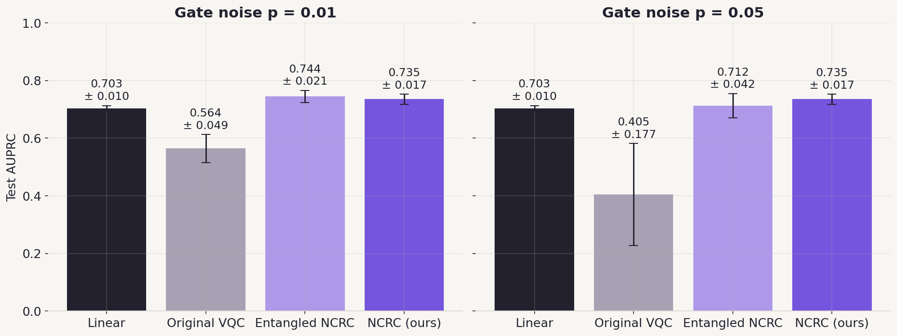
*Figure 1 (`results/canva/headline_auprc.png`): Primary competition metric — Test AUPRC at $p = 0.01$ and $p = 0.05$ across 5 seeds. NCRC (`0.735 ± 0.017`) is invariant across noise levels, surpassing Logistic Regression (`0.703 ± 0.010`), Entangled NCRC at high noise (`0.712 ± 0.042`), and the Original VQC (`0.405 ± 0.177`).*

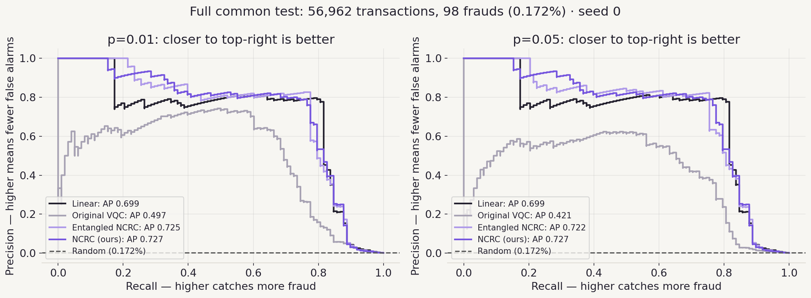
*Figure 2 (`results/canva/pr_curves.png`): Full test set Precision–Recall curves (seed 0) at $p = 0.01$ and $p = 0.05$. Our NCRC curve (`AP = 0.727`) is identical across both panels, whereas the Original VQC curve collapses (`0.497 → 0.421`).*

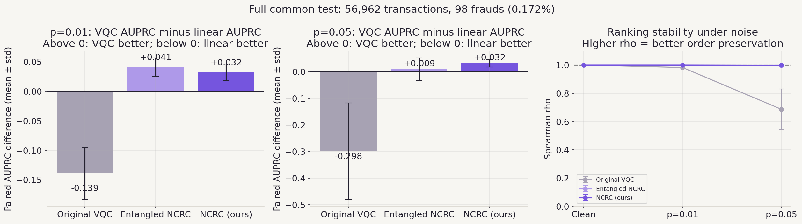
*Figure 3 (`results/canva/delta_rho.png`): Left & center — paired per-seed AUPRC difference against Logistic Regression (removing seed-to-seed undersampling variance; NCRC maintains `+0.032` at both $p = 0.01$ and $p = 0.05$). Right — Spearman $\rho$ between noisy and clean test scores ($\rho = 1.000$ for NCRC vs. `0.686 ± 0.145` for Original VQC at $p = 0.05$).*

---

### 3.2 Score Contraction Geometry, Decision Surfaces & Alert Decisions
To verify visually *why* NCRC preserves ranking and decision quality under noise:
- At $p = 0.05$, every single transaction's NCRC expectation value shrinks by the exact theoretical factor $(1 - \frac{4 \times 0.05}{3})^4 = 0.758835\dots$, placing every noiseless-vs-noisy score pair onto a single straight line of slope `0.7588` through `(0.5, 0.5)`.
- Over the 2D input slice of encoded angles $(x_1, x_2) \in [0, \pi]^2$, Logistic Regression is restricted to a flat hyperplane, the Original VQC shatters into low-amplitude islands ($\pm 0.02$ around threshold), and NCRC maintains smooth nonlinear decision contours ($\pm 0.40$ margin).
- Across the 5 seeds at $p = 0.05$, NCRC catches **77.0 / 98 frauds** with **27.2 false alarms** on average (with pairwise ranking loss: **76.0 caught / 16.8 false alarms**), compared with **61.0 caught / 83.4 false alarms** for the Baseline VQC and **79.2 caught / 23.0 false alarms** for Logistic Regression.

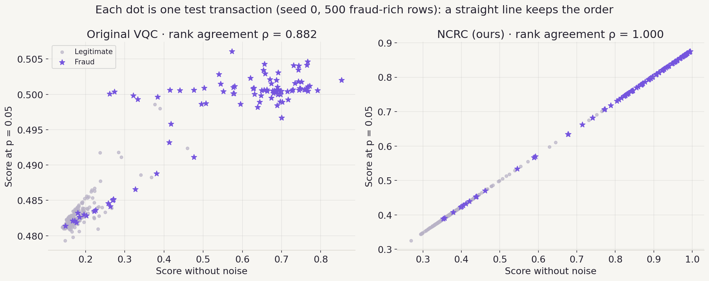
*Figure 4 (`results/canva/per_transaction.png`): Clean vs. $p = 0.05$ noisy test scores (seed 0, 500 fraud-rich rows). Original VQC scores compress into a scrambled `0.48–0.51` band ($\rho = 0.882$); NCRC maps every transaction along a strict straight line ($\rho = 1.000$).*

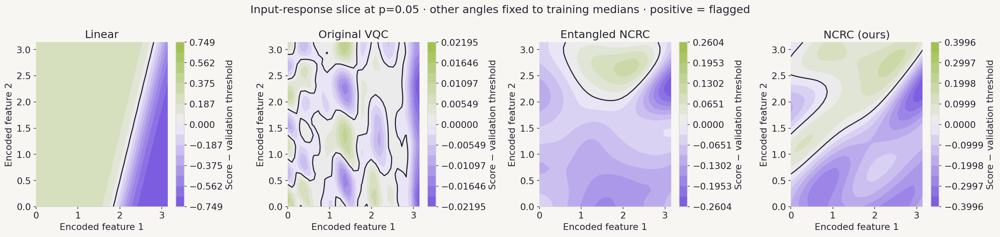
*Figure 5 (`results/canva/slices.png`): Score minus validation threshold across encoded features 1 and 2 at $p = 0.05$ (features 3 and 4 fixed at training medians; seed 0). Re-uploading provides curved decision boundaries without entangling gates.*

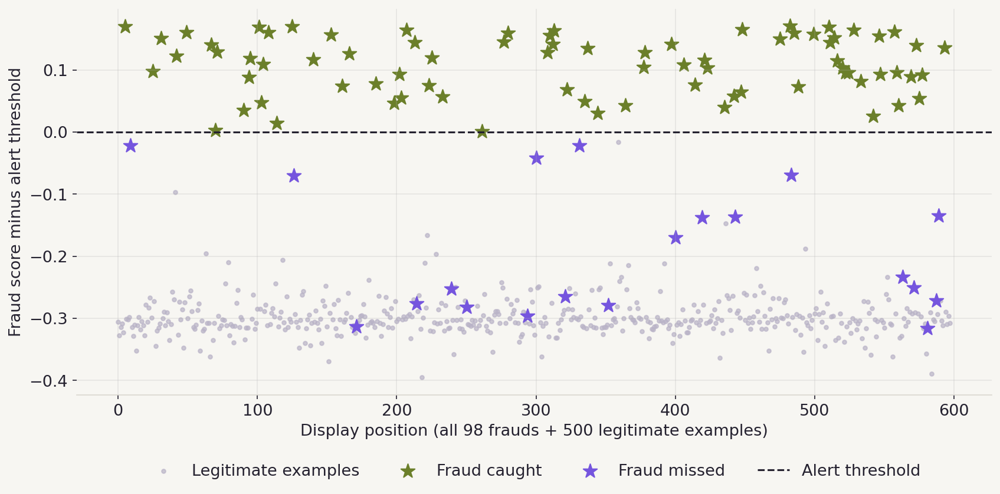
*Figure 6 (`results/canva/threshold_ours.png`): NCRC fraud score minus noise-calibrated validation threshold at $p = 0.05$ (seed 0; all 98 test frauds + 500 random legitimate payments displayed). Exactly 78 of 98 frauds sit above threshold — identical at $p = 0$, $0.01$, and $0.05$.*

---

### 3.3 Hardware Cost Ledger
Circuit executions are accounted on a realistic shot-based quantum backend (`1,024` shots/execution):
- **Training Executions:** $\text{Epochs} \times 590 \times E_{\text{sample}}$, where $E_{\text{sample}}$ is measured with `qml.Tracker` (or `PackedNCRCGradient`'s compiled shift schedule).
- **Validation Executions:** $\text{Validation Passes} \times N_{\text{val\_scored}}$, at 1 forward circuit execution per row.

| Configuration | Tag | Exec / Sample | Train Executions | Val Executions | Total Executions | Total Shots ($\times 10^9$) | vs. Baseline | Test AUPRC ($p = 0.05$) |
|---|---|---:|---:|---:|---:|---:|---:|---:|
| Baseline (naive formula, $P=32$) | — | 65 | 1,150,500 | 1,708,860 | 2,859,360 | 2.93 | +17.4% | 0.405 ± 0.177 |
| **Baseline (`qml.Tracker`, $P_{\text{active}}=20$)** | `baseline` | **41** | **725,700** | **1,708,860** | **2,434,560** | **2.49** | **0.0%** | **0.405 ± 0.177** |
| Entangled NCRC (30 ep, full val) | `ncrc_4q_L4_cnot` | 97 | 1,716,900 | 1,708,860 | 3,425,760 | 3.51 | +40.7% | 0.712 ± 0.042 |
| NCRC 4q L4 (pruned, standard shift) | `ncrc_4q_L4` | 81 | 1,433,700 | 1,708,860 | 3,142,560 | 3.22 | +29.1% | 0.735 ± 0.017 |
| **NCRC 4q L4 (packed gradients, default)** | `ncrc_4q_L4_packed` | **15** | **265,500** | **1,708,860** | **1,974,360** | **2.02** | **−18.9%** | **0.735 ± 0.017** |
| NCRC 4q L4 (cheap, standard shift) | `ncrc_4q_L4_cheap` | 81 | 716,850 | 170,880 | 887,730 | 0.91 | −63.5% | 0.721 ± 0.021 |
| **NCRC 4q L4 (cheap + packed)** | `ncrc_4q_L4_cheap_packed` | **15** | **132,750** | **170,880** | **303,630** | **0.31** | **−87.5%** | **0.721 ± 0.021** |
| NCRC 1q L2 Pruned (30 ep, full val) | `ncrc_1q_L2_pruned` | 9 | 159,300 | 1,708,860 | 1,868,160 | 1.91 | −23.3% | 0.718 ± 0.033 |
| **NCRC 1q L2 Pruned (cheap)** | `ncrc_1q_L2_pruned_cheap` | **9** | **79,650** | **170,880** | **250,530** | **0.26** | **−89.7%** | **0.685 ± 0.047** |

> **Note:** Zero-Noise Extrapolation (ZNE) and post-selection are *not* required by NCRC, avoiding any hidden $3\times$–$5\times$ inference execution multiplier.

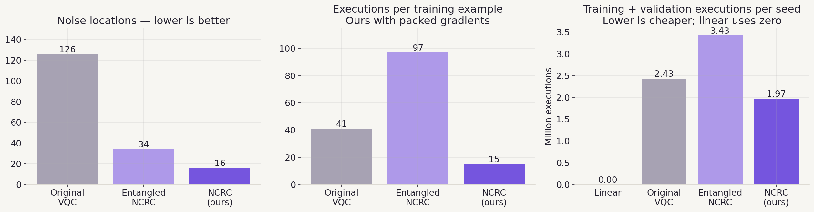
*Figure 7 (`results/canva/cost.png`): Noise locations (`126 → 16`), parameter-shift executions per training sample (`41 → 15` with packed gradients), and total training + validation executions per seed (`2.43M → 1.97M` on the full schedule).*

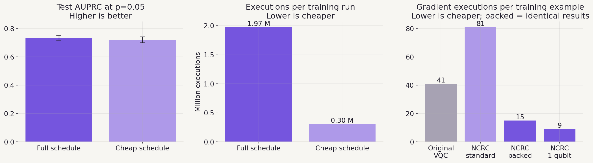
*Figure 8 (`results/canva/schedule_gradients.png`): Full vs. cheap validation schedule (`1.97M → 0.30M` executions for `0.735 → 0.721` AUPRC) and per-example gradient runs across architectures.*

---

### 3.4 Ablations & Honest Negative Results
We systematically ablated wire count, re-uploading depth, entanglement, angle pruning, validation budget, and loss formulation across 12 model configurations:

1. **Adding CNOT Entanglement Hurts Under Noise (`ncrc_4q_L4_cnot`):** Inserting a linear CNOT chain between layers slightly improves clean AUPRC (`0.744 ± 0.022` vs. `0.735 ± 0.017`) but breaks noise covariance—dropping AUPRC to `0.712 ± 0.042` at $p = 0.05$ (`2.5×` larger seed spread) and `0.687 ± 0.032` under amplitude damping, while preventing parallel wire gradient packing (`97` vs. `15` exec/sample).
2. **Deeper Single-Qubit Circuits Overfit / Destabilize (`ncrc_1q_L2` $\to$ `L4` $\to$ `L6`):** Increasing layers on a single wire from `2` to `4` and `6` *lowered* both validation AUPRC (`0.698 → 0.692 → 0.675`) and test AUPRC (`0.718 ± 0.033 → 0.699 ± 0.075 → 0.700 ± 0.023`). Width (4 ensemble wires at depth 4) was strictly superior to depth on 1 wire.
3. **Pairwise Ranking Loss Trade-off (`ncrc_4q_L4_pairwise05`):** Consistently improved thresholded $F_1$ on **5 / 5 seeds** (`0.763 → 0.796`), outperforming Logistic Regression (`0.791`), and raised mean AUPRC (`0.735 → 0.747`), but per-seed AUPRC improved on only **3 / 5 seeds** (`+0.028, +0.041, −0.013, −0.016, +0.020`) and currently requires `97` exec/sample; therefore we kept plain BCE as the conservative headline.
4. **Exploratory Mitigations Tested in Parallel Notebooks:** Zero-Noise Extrapolation (ZNE) restored shrunk score magnitudes toward clean values without improving AUPRC (since monotone rescaling cannot un-scramble an entangled circuit's ranking) while doubling/tripling inference executions; Noise-Aware Training (NAT) on entangled circuits reduced seed variance but reached only `0.605` test AUPRC at $p = 0.05$.

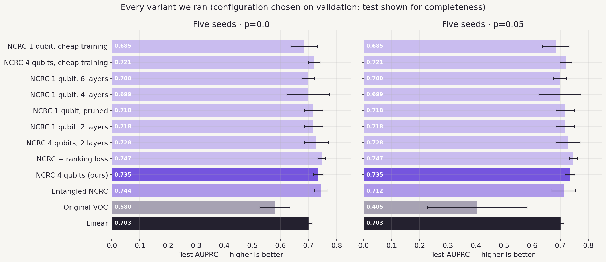
*Figure 9 (`results/canva/ablations.png`): Five-seed test AUPRC at $p = 0.0$ and $p = 0.05$ across all 12 evaluated variants. Every unentangled NCRC configuration preserves its exact clean AUPRC at $p = 0.05$.*

---

### 3.5 Stress Tests Beyond the Official Protocol

#### A. Realistic 1,024-Shot Readout (`src/shots.py`)
Exact density matrices correspond to $\infty$ measurement shots. To test realistic hardware readout on all `56,962` test transactions (`5 seeds × 5 shot draws`), we sampled `1,024` shots per execution matched to each model's readout structure:
- **Baseline VQC (1 readout wire):** $\text{Binomial}(1024, P(1)) / 1024$.
- **Unentangled NCRC (4 independent wires):** 4 independent $\text{Binomial}(1024, P_q(1)) / 1024$ draws averaged across wires.
- **Entangled NCRC (4 correlated wires):** $\text{Multinomial}(1024, p_{0000 \dots 1111})$ over all 16 computational basis bitstrings.

| Model | $p = 0.00$ (1,024 shots) | $p = 0.01$ (1,024 shots) | $p = 0.05$ (Exact) | $p = 0.05$ (1,024 shots) | Shot Spearman $\rho$ ($p = 0.05$) |
|---|---:|---:|---:|---:|---:|
| Baseline VQC | 0.578 ± 0.048 | 0.554 ± 0.038 | 0.405 ± 0.177 | **0.013 ± 0.008** | 0.032 ± 0.023 |
| Entangled NCRC | 0.743 ± 0.022 | 0.741 ± 0.022 | 0.712 ± 0.042 | 0.708 ± 0.032 | 0.703 ± 0.107 |
| Pruned 1q NCRC (`L2`) | 0.715 ± 0.033 | 0.714 ± 0.033 | 0.718 ± 0.033 | 0.710 ± 0.034 | 0.785 ± 0.088 |
| **NCRC 4q L4 (ours)** | **0.735 ± 0.017** | **0.735 ± 0.018** | **0.735 ± 0.017** | **0.733 ± 0.019** | **0.899 ± 0.051** |
| NCRC + Ranking Loss | 0.746 ± 0.014 | 0.745 ± 0.016 | 0.747 ± 0.014 | 0.742 ± 0.014 | 0.903 ± 0.051 |

At $p = 0.05$, 126 noise locations squeeze the Baseline's score spread narrower than binomial shot noise ($\sigma \approx 0.016$), collapsing AUPRC to `0.013` (random-level). NCRC retains `75.9%` of its clean signal amplitude and halves shot noise across 4 wires, losing only `0.002` AUPRC (`0.735 → 0.733`).

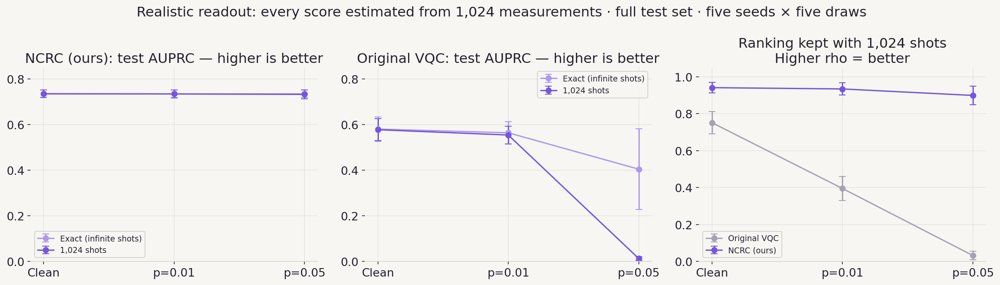
*Figure 10 (`results/canva/shots.png`): Exact ($\infty$-shot) vs. 1,024-shot test AUPRC and Spearman $\rho$ across the full 56,962-row test set (`5 seeds × 5 draws`).*

#### B. Dense Protocol & Extreme-Noise Stress Sweeps (`src/sweep.py`)
To verify behavior between and far beyond the 4 official noise points without linear interpolation:
- **Dense Official Protocol Sweep (Left):** `21` measured noise levels $p \in [0, 0.05]$ on the full `56,962`-row test set (exact). Baseline erodes smoothly (`0.580 → 0.564 → 0.543 → 0.512 → 0.456 → 0.405`); NCRC stays flat at `0.735` across all 21 evaluations.
- **Extreme-Noise Stress Sweep (Right):** `26` measured levels $p \in [0, 0.50]$ with `1,024` shots on a fraud-rich `500`-row test set (`98` frauds + `402` legit, `20%` positive rate; random AUPRC = `0.20`). With finite shots under extreme noise, quantum models fail in strict architectural order: **Baseline ($p \approx 0.08$) $\to$ Entangled NCRC ($p \approx 0.25$) $\to$ 4q NCRC ($p \in [0.40, 0.50]$)**, while the shallow **1-qubit 2-gate NCRC still achieves `0.906` AUPRC at $p = 0.50$**.

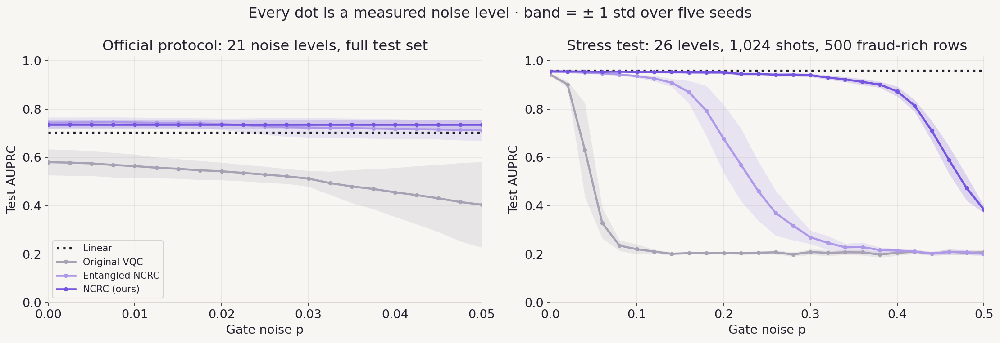
*Figure 11 (`results/canva/sweeps.png`): Every dot is a full 5-seed evaluation ($\pm 1\text{ std}$ shaded band). Note: right-panel AUPRC values use the 20%-fraud stress set (`random = 0.20`) and are not directly comparable to 0.172%-fraud full-test AUPRCs.*

#### C. Non-Covariant Physical Channels & Heterogeneous Per-Gate Noise (`src/noise_types.py`)
Because real hardware exhibits $T_1$ relaxation, $T_2$ dephasing, bit flips, and gate-to-gate calibration spread that **do not commute** with arbitrary rotations:
- **Full-Protocol Amplitude Damping ($\gamma = 0.05$ after every native gate on all `56,962` test rows):** Exact invariance bends slightly as predicted, yet `ncrc_4q_L4` retains **`0.728 ± 0.025` AUPRC** ($\Delta = -0.007$, Spearman $\rho = 0.999 \pm 0.001$), beating `ncrc_4q_L4_cnot` (`0.687 ± 0.032`) and `baseline` (`0.551 ± 0.051`).
- **Six Noise Regimes & Worst-Single-Run Audit (`500`-row fraud-rich set, mean noise $p = 0.20$):** Evaluated across uniform Depolarizing, Amplitude Damping, Phase Damping, and Bit Flip, plus **Uneven Depolarizing** ($p_k \sim U(0, 2p)$ per gate location) and **Uneven Mixed** (random channel type *and* random strength per gate across `5 random devices × 5 seeds = 25 runs`). Our **worst single run anywhere is `0.93`** (vs. `0.957` clean), whereas the Baseline's worst runs plunge to **`0.11`** (below random `0.20`, with inverted rankings down to $\rho = -0.931$) and Entangled NCRC drops to `0.69`.

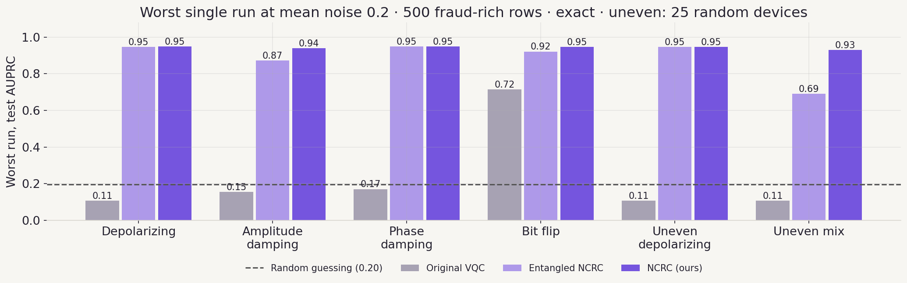
*Figure 12 (`results/canva/noise_types.png`): Minimum (worst-case) single-run test AUPRC at mean gate noise `0.20` across 6 physical and heterogeneous noise regimes (`25` device-seed runs for uneven channels).*

---

## 4. Project Structure

The repository layout is organized for clean separation between challenge specifications, core quantum/ML modules, automated tests, cached per-seed JSON ledgers/metrics, and presentation sources:

```text
.
├── Hackathon Tasks/
│   ├── Fraud on a Quantum Budget - Task.pdf          # Official 9-page challenge specification & rules
│   └── task1_guided_vqc_fraud_detection.ipynb        # Guided Task 1 reference pipeline & protocol anchor
├── data/                                             # Git-ignored; place ULB creditcard.csv (~150 MB) here
├── presentation/
│   ├── Fraud detection under noise (Canva version).pptx  # Final 20-slide competition presentation deck
│   └── canva/
│       └── project/
│           ├── deck.json                             # Slide ordering & metadata manifest
│           └── slides/                               # 20 modular HTML slide sources (cover.html, circuit.html, ...)
├── results/
│   ├── summary.csv                                   # Aggregated mean ± std CSV across all models & noise levels
│   ├── summary.md                                    # Human-readable Markdown tables for all models & finite shots
│   ├── noise_types_summary.md                        # Mean, worst-run AUPRC & worst Spearman ρ across 6 noise regimes
│   ├── metrics_vs_noise.png                          # Official protocol metrics vs. depolarizing p
│   ├── deck_noise.png                                # 4-level AUPRC, ΔAUPRC, and Spearman ρ summary plot
│   ├── noise_types.png                               # All-runs multi-channel & heterogeneous noise trajectories
│   ├── sweep_protocol.png                            # 21-level dense official protocol sweep figure
│   ├── sweep_stress.png                              # 26-level dense 1,024-shot extreme-noise sweep figure
│   ├── canva/                                        # 15 publication-grade figures generated by src/plot_canva.py
│   │   ├── headline_auprc.png                        #   Main p=0.01 & p=0.05 AUPRC bar comparison
│   │   ├── bars_auprc_f1.png                         #   2×2 AUPRC and F1 bar grid with random baseline
│   │   ├── pr_curves.png                             #   Seed-0 full-test Precision–Recall curves
│   │   ├── delta_rho.png                             #   Paired ΔAUPRC vs. Logistic Regression & Spearman ρ
│   │   ├── per_transaction.png                       #   Clean vs. noisy score scatter showing exact affine line
│   │   ├── slices.png                                #   2D input-response decision boundary contours at p=0.05
│   │   ├── threshold_ours.png                        #   Test frauds vs. noise-calibrated alert threshold (ours)
│   │   ├── threshold_grid.png                        #   4-model × 2-noise-level threshold margin grid
│   │   ├── confusion.png                             #   Seed-0 full-test confusion matrices (p=0.01, 0.05)
│   │   ├── cost.png                                  #   Noise locations, execs/sample, and total runs/seed
│   │   ├── schedule_gradients.png                    #   Full vs. cheap schedule & gradient packing comparison
│   │   ├── ablations.png                             #   All 12 evaluated variants at p=0.0 and p=0.05
│   │   ├── shots.png                                 #   Exact vs. 1,024-shot readout AUPRC & Spearman ρ
│   │   ├── sweeps.png                                #   Combined dense protocol + extreme stress sweeps
│   │   └── noise_types.png                           #   Worst-single-run bar chart across 6 noise regimes
│   ├── slides/                                       # Additional slide figures & cached scores_seed0.npz
│   ├── raw/                                          # Per-model, per-seed JSONs (metrics, history, resources, ledger)
│   ├── shots/                                        # 1,024-shot evaluation JSONs (5 seeds × 5 draws)
│   ├── noise_types/                                  # 6-noise-regime & 25-device uneven noise JSONs
│   └── sweep/
│       ├── protocol/                                 # 21-level full-test sweep JSONs
│       └── stress/                                   # 26-level 1,024-shot stress sweep JSONs
├── src/
│   ├── common.py                                     # Data split, AngleEncoder, baseline VQC, train_vqc,
│   │                                                 #   PackedNCRCGradient, noisy_qnode, protocol, qml.Tracker ledger
│   ├── models.py                                     # NCRC circuit builder & MODELS registry (10 VQC configs)
│   ├── run.py                                        # CLI driver: trains & evaluates 1 model × 1 seed → results/raw/
│   ├── shots.py                                      # Realistic 1,024-shot test evaluation → results/shots/
│   ├── stress.py                                     # Builds leak-free 500-row (20% fraud) val/test stress sets
│   ├── sweep.py                                      # Dense noise sweeps (--mode protocol | stress) → results/sweep/
│   ├── noise_types.py                                # Multi-channel & per-gate uneven noise runner → results/noise_types/
│   ├── demo_seed0.py                                 # Recomputes & verifies seed-0 per-payment scores + 2D grid
│   ├── report.py                                     # Compiles results/raw/*.json → summary.csv, summary.md & metrics_vs_noise.png
│   ├── plot_canva.py                                 # Generates all 15 figures in results/canva/
│   ├── plot_deck.py                                  # Generates results/deck_noise.png
│   ├── plot_noise_types.py                           # Generates results/noise_types.png & noise_types_summary.md
│   ├── plot_slides.py                                # Generates results/slides/*.png
│   └── plot_sweep.py                                 # Generates results/sweep_protocol.png & sweep_stress.png
├── tests/
│   ├── test_packed_gradient.py                       # Asserts packed gradients & Adam step match backprop to 1e-9
│   └── test_pairwise_loss.py                         # Asserts pairwise softplus ranking loss trains cleanly
├── .gitignore                                        # Excludes raw dataset (data/*.csv), caches, venvs & run logs
├── README.md                                         # Repository documentation & results guide
├── reproduce.sh                                      # End-to-end parallel reproduction script (all runs + plots)
├── requirements.txt                                  # Pinned Python environment (PennyLane 0.45.1, PyTorch 2.14.1, ...)
└── split_indices.npz                                 # Official common 60/20/20 stratified split (seed 42)
```

### Quick-Start & Reproduction Commands
```bash
# 1. Install pinned dependencies
pip install -r requirements.txt

# 2. Place ULB dataset at data/creditcard.csv (split_indices.npz is already included and verified)

# 3. Run unit tests (gradient equivalence & ranking loss)
python -m unittest discover -s tests

# 4. Run a single headline NCRC seed end-to-end (takes ~1–2 minutes)
PYTHONIOENCODING=utf-8 python src/run.py --model ncrc_4q_L4 --seed 0

# 5. Reproduce every experiment, sweep, shot test, summary table, and figure in parallel
PYTHON=python PARALLEL=6 ./reproduce.sh
```
*(Note: On Windows PowerShell/CMD consoles using `cp1250`, set `PYTHONIOENCODING=utf-8` to prevent Unicode encoding errors when printing symbols such as `ρ` or `±`.)*

---

## 5. Verification, Nuances & Information Worth Mentioning

### 5.1 Multi-Layer Independent Verification
Because exact flat lines under depolarizing noise look surprising at first glance, every claim was subjected to independent cross-checks:
1. **Unit-Tested Analytic Gradient Equivalence (`tests/test_packed_gradient.py`):** Confirms `PackedNCRCGradient` (`euler`, `parallel`, and `combined` 15-run modes) matches standard PyTorch backpropagation gradients and a full Adam parameter step within `1e-9` at both $p = 0$ and $p = 0.05$, and confirms endpoint $Z$-pruning preserves circuit outputs within `1e-14`.
2. **Built-in Runtime Self-Assertions:**
   - `common.py::load_data` asserts exact official partition counts `(56962 test rows, 98 test frauds, 99 val frauds)` and indexes via `.loc[split[name]]` on the un-reindexed DataFrame so label indices are never misinterpreted as positional offsets.
   - `shots.py` simulates noisy wire expectations via `default.mixed` density matrices and asserts agreement with $\langle Z_q \rangle_0 \cdot (1 - \frac{4p}{3})^L$ within `1e-9`.
   - `noise_types.py` asserts its custom per-gate noise transform matches PennyLane's `qml.noise.insert` within `1e-9` under uniform depolarizing noise.
   - `demo_seed0.py` asserts recomputed seed-0 test AUPRCs match stored `results/raw/*.json` runs within `1e-6`.
3. **Independent Pure-NumPy Kraus Simulation:** Seed 0 of `ncrc_4q_L4` was re-implemented from scratch using $2 \times 2$ NumPy density matrices and explicit Kraus operators (no PennyLane), matching clean scores to `7e-16` and reproducing all 16 checked multi-channel / heterogeneous AUPRC values to 4 decimal places.
4. **Independent Teammate Pipeline Cross-Check:** A separate from-scratch notebook run on `split_indices.npz` reproduced `baseline` (`0.564` at $p = 0.01$, `0.405` at $p = 0.05$) and `logreg` (`0.703`, seed 0 catching `80` frauds with `28` false alarms) identically.

### 5.2 Important Technical Nuances & Lessons Learned
- **Shot Sampling Must Match Multi-Qubit Readout Correlations:** Approximating a 4-wire mean-$\langle Z \rangle$ score with a single pooled $\text{Binomial}(1024, \bar{p})$ draw artificially inflates shot variance by $4\times$ for independent wires and ~2× for entangled wires. During an internal audit, replacing pooled sampling with exact 16-outcome joint bitstring Multinomial sampling (`qml.probs`) on `ncrc_4q_L4_cnot` moved its stress-test breakdown point from $p \approx 0.20$ (`0.435` AUPRC) to $p \approx 0.25$ (`0.677` at $p = 0.20$), ensuring the ablation comparison is completely fair.
- **Inference Ranking Invariance $\neq$ Training Invariance:** While any *fixed* set of NCRC weights yields identical rankings at all $p \in [0, 0.75)$, training inside depolarizing noise (Noise-Aware Training) is **not** a no-op: `BCELoss` is nonlinear in the contracted probabilities $0.5 + \lambda^k(s_0 - 0.5)$, which reweights gradient magnitudes across easy vs. hard examples and converges to different weights.
- **Exact Functional Pruning vs. Chaotic Trajectory Rounding:** Endpoint $Z$-pruning preserves exact forward scores and gradients to machine precision ($\sim 10^{-16}$), producing identical 5-seed test metrics on `ncrc_1q_L2` and `ncrc_4q_L4` (within `< 1e-6`). However, on the unstable 4-layer single-qubit ablation (`ncrc_1q_L4_pruned`, seed 1), $10^{-16}$ floating-point differences amplified across an erratic late-epoch plateau and shifted checkpoint selection (`0.574` vs. `0.540`).
- **Comparing Full-Test vs. Stress-Test AUPRCs:** Headline AUPRCs (`0.735`) are evaluated on the natural `0.172%`-fraud test set (`random = 0.00172`), whereas high-noise stress sweeps and multi-channel worst-run charts (`~0.95`) use the `500`-row fraud-rich set (`20%` fraud, `random = 0.20`) requested to keep 26-level × 25-run density-matrix simulations computationally tractable. Numbers must never be compared across the two base rates.
- **Scientific Honesty & Scope (No Quantum Advantage Claim):** Because `ncrc_4q_L4` contains no entangling gates, its 4 qubits factorize into four $2 \times 2$ evolutions that are trivially simulable on a classical CPU. Moreover, classical `LogisticRegression` trains in milliseconds, requires zero quantum hardware, is immune to gate noise, and retains higher single-threshold $F_1$ than plain-BCE NCRC (`0.791` vs. `0.763`, closed to `0.796` with the pairwise loss). Following Bowles, Ahmed & Schuld (2024) [4], we make **no claim of quantum advantage over classical ML**—our contribution is demonstrating how symmetry-aware circuit design (`NCRC`) and compiled parameter-shift scheduling (`PackedNCRCGradient`) make a VQC noise-resilient and budget-viable.

---

## 6. References

1. **Dinuț, M.-A., Constantinescu, R., & Alexandrescu, A. (2026).** *Comparative analysis and noise robustness study of quantum kernel methods and variational quantum classifiers for financial fraud detection.* Electronics, 15(11), 2489. https://doi.org/10.3390/electronics15112489
2. **Dal Pozzolo, A., Caelen, O., Johnson, R. A., & Bontempi, G. (2015).** *Calibrating probability with undersampling for unbalanced classification.* IEEE Symposium Series on Computational Intelligence (SSCI), 159–166. https://doi.org/10.1109/SSCI.2015.33
3. **Pérez-Salinas, A., Cervera-Lierta, A., Gil-Fuster, E., & Latorre, J. I. (2020).** *Data re-uploading for a universal quantum classifier.* Quantum, 4, 226. https://doi.org/10.22331/q-2020-02-06-226
4. **Bowles, J., Ahmed, S., & Schuld, M. (2024).** *Better than classical? The subtle art of benchmarking quantum machine learning models.* arXiv:2403.07059. https://arxiv.org/abs/2403.07059
5. **Schuld, M., Bergholm, V., Gogolin, C., Izaac, J., & Killoran, N. (2019).** *Evaluating analytic gradients on quantum hardware.* Physical Review A, 99(3), 032331. https://doi.org/10.1103/PhysRevA.99.032331
6. **Sharma, K., Khatri, S., Cerezo, M., & Coles, P. J. (2020).** *Noise resilience of variational quantum compiling.* New Journal of Physics, 22(4), 043006. https://doi.org/10.1088/1367-2630/ab784c
